# Optimal Control of COVID-19 with an SEIQ Model


**How should a limited budget for vaccination and treatment be spent over time to keep an epidemic as small as possible?**

This repository answers that question for an SEIQ (Susceptible–Exposed–Infectious–Quarantined) model of COVID-19. It goes from the model, through its stability and bifurcation analysis, to an optimal control problem solved with Pontryagin's maximum principle. It then fits the model to noisy data and checks whether the optimal policy survives the parameter uncertainty.

> **Key findings**
> 1. The disease-free state loses stability at **R₀ = 1** through a **forward (transcritical) bifurcation**, so pushing R₀ below 1 is enough to eliminate the disease.
> 2. Optimal control cuts the outbreak peak from **316 to 110** infected people and infected person-days by **88%**. **Vaccination does most of the work.**
> 3. The optimal policy is **front-loaded**: vaccinate from day 0, then relax.
> 4. When the model is fitted to noisy case data, two parameters cannot be told apart (correlation ≈ 0.99). Even so, the **timing** of the optimal policy is the same for all 300 posterior samples. Its **intensity** depends on the cost weights.

*Originally a Modelling Camp project in the Erasmus Mundus MathMods programme (University of L'Aquila & Universität Hamburg), by Jonas Kwame Nyador, Justice Addae and Kingsley Opoku. It was revisited, corrected and extended in 2026.*

---

## Contents

1. [The model](#1-the-model)
2. [Threshold analysis: R₀ and stability](#2-threshold-analysis-r₀-and-stability)
3. [Bifurcation analysis](#3-bifurcation-analysis)
4. [The optimal control problem](#4-the-optimal-control-problem)
5. [Pontryagin's maximum principle](#5-pontryagins-maximum-principle)
6. [Numerical method: forward–backward sweep](#6-numerical-method-forwardbackward-sweep)
7. [Results](#7-results)
8. [Fitting the model to data](#8-fitting-the-model-to-data)
9. [Does the policy survive the uncertainty?](#9-does-the-policy-survive-the-uncertainty)
10. [Repository structure and how to run](#10-repository-structure-and-how-to-run)
11. [Limitations and honest notes](#11-limitations-and-honest-notes)
12. [References](#12-references)

---

## 1. The model

The population is divided into four compartments. Every term that leaves one compartment enters another, plus births/recruitment ($A$), natural deaths ($\mu$) and disease deaths ($\alpha$).

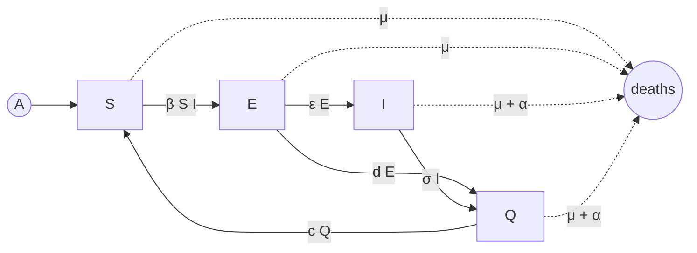

$$
\begin{aligned}
S' &= A - \beta S I - \mu S + c\,Q \\
E' &= \beta S I - (\varepsilon + \mu + d)\,E \\
I' &= \varepsilon E - (\alpha + \mu + \sigma)\,I \\
Q' &= \sigma I + d E - (\alpha + \mu + c)\,Q
\end{aligned}
$$

| Symbol | Meaning | Value |
|---|---|---|
| $A$ | recruitment rate | 0.001 |
| $\beta$ | transmission rate | 0.0006515 |
| $\varepsilon$ | rate E → I (1 / latent period) | 0.1667 |
| $d$ | rate E → Q (direct quarantine of exposed people) | 0.05 |
| $\sigma$ | rate I → Q (quarantine of infectious people) | 0.50 |
| $c$ | rate Q → S (return from quarantine) | 0.00017 |
| $\mu$ | natural death rate | 0.00021 |
| $\alpha$ | disease-induced death rate | 0.000015 |
| $S_0, E_0, I_0, Q_0$ | initial values | 2000, 1000, 70, 20 |

Parameters come from Giordano et al. (2020), the WHO and Index Mundi, as in the original report.

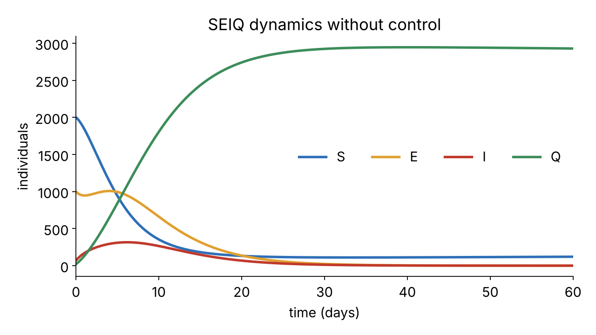

*Without control, infections peak at about 316 around day 6.*

---

## 2. Threshold analysis: R₀ and stability

**Disease-free equilibrium (DFE).** Setting $E = I = Q = 0$ gives $S^* = A/\mu$.

**Basic reproduction number.** With the next-generation matrix method (van den Driessche & Watmough, 2002), the infected compartments are $(E, I)$:

$$
F = \begin{pmatrix} 0 & \beta S^* \\ 0 & 0 \end{pmatrix}, \qquad
V = \begin{pmatrix} \varepsilon + \mu + d & 0 \\ -\varepsilon & \alpha + \mu + \sigma \end{pmatrix}, \qquad
R_0 = \rho(FV^{-1}) = \frac{\varepsilon\,\beta\,A}{\mu\,(\varepsilon + \mu + d)(\alpha + \mu + \sigma)} .
$$

**Local stability.** The Routh–Hurwitz criteria on the Jacobian at the DFE show that it is locally asymptotically stable when $R_0 < 1$.

**Global stability.** With the Lyapunov function $V = \varepsilon E + (\varepsilon + \mu + d)\,I$, and using $S \le A/\mu$ on the feasible region:

$$
V' = \big[\varepsilon \beta S - (\varepsilon + \mu + d)(\alpha + \mu + \sigma)\big]\, I
\;\le\; (\varepsilon + \mu + d)(\alpha + \mu + \sigma)\,(R_0 - 1)\, I \;\le\; 0
\quad \text{when } R_0 \le 1 .
$$

So, by LaSalle's invariance principle, the DFE is globally asymptotically stable for $R_0 \le 1$.

> **A detail worth noting.** With the report's parameters, $R_0 \approx 0.005$, yet an outbreak still happens. The reason is that $S_0 = 2000$ is far above the model's own equilibrium $S^* = A/\mu \approx 4.8$. The reproduction number at the start of the simulation is $\varepsilon\beta S_0 / [(\varepsilon+\mu+d)(\alpha+\mu+\sigma)] \approx 2.0$, so the outbreak is a transient before the solution returns to the DFE. Sections 3, 8 and 9 therefore use a **consistent** version of the model (population $N = 10\,000$, $A = \mu N$, transmission $\tilde\beta\, S I / N$ with $\tilde\beta = \beta \cdot 2000 \approx 1.3$), where $R_0 \approx 2.0$.

---

## 3. Bifurcation analysis

In the consistent model, the **endemic equilibrium** has a closed form:

$$
S^* = \frac{N}{R_0}, \qquad
I^* = \frac{\mu N \,(1 - 1/R_0)}{\dfrac{(\varepsilon+\mu+d)(\alpha+\mu+\sigma)}{\varepsilon} - \dfrac{c\,\big(\sigma + d(\alpha+\mu+\sigma)/\varepsilon\big)}{\alpha+\mu+c}}, \qquad
E^* = \frac{(\alpha+\mu+\sigma)\, I^*}{\varepsilon}, \qquad
Q^* = \frac{\sigma I^* + d E^*}{\alpha + \mu + c}.
$$

A positive endemic equilibrium therefore exists **if and only if $R_0 > 1$**. At $R_0 = 1$ it crosses the disease-free branch and the two exchange stability: a **forward (transcritical) bifurcation**. Stability along the whole branch was checked from the Jacobian eigenvalues. Because there is **no backward bifurcation**, reducing $R_0$ below 1 is sufficient for elimination.

With constant controls (vaccination $u_1$, treatment $u_2$), $R_0$ becomes the **control reproduction number**:

$$
R_c(u_1, u_2) = \tilde\beta \cdot \frac{\mu}{\mu + u_1} \cdot \frac{\varepsilon}{(\varepsilon + \mu + d + u_1)(\alpha + \mu + \sigma + u_2)} .
$$

Treatment alone needs $u_2 \gtrsim 0.50$ per day to reach $R_c < 1$. A constant vaccination rate of only $u_1 \approx 2 \times 10^{-4}$ per day suffices *in the long run*, because it shrinks the susceptible pool.

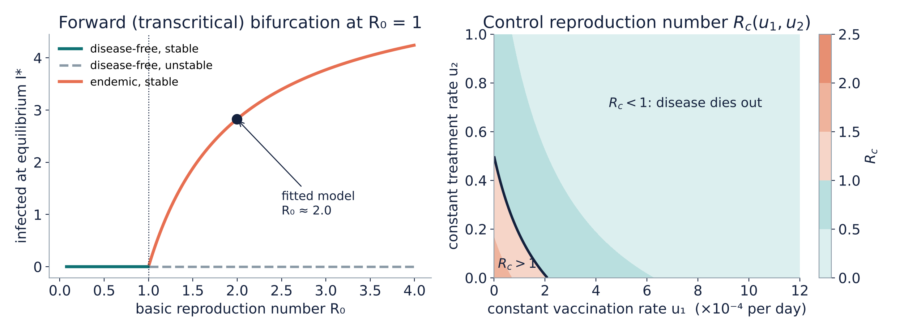

*Left: equilibria against $R_0$. The disease-free state (teal) is stable for $R_0 < 1$; the endemic state (orange) emerges at $R_0 = 1$; the fitted model sits at $R_0 \approx 2$. Right: $R_c$ for constant controls, with the line $R_c = 1$ separating die-out from persistence.*

> Equilibria live on the demographic time scale $1/\mu \approx 13$ years. The bifurcation analysis answers the long-term **elimination** question; the optimal control below answers how to manage the **outbreak** over 100 days.

---

## 4. The optimal control problem

Two time-dependent controls are added:

- $u_1(t)$, **vaccination**, removes susceptible and exposed individuals;
- $u_2(t)$, **treatment**, removes infectious individuals.

$$
\begin{aligned}
S' &= A - \beta S I - \mu S + c\,Q - u_1 S \\
E' &= \beta S I - (\varepsilon + \mu + d)\,E - u_1 E \\
I' &= \varepsilon E - (\alpha + \mu + \sigma)\,I - u_2 I \\
Q' &= \sigma I + d E - (\alpha + \mu + c)\,Q
\end{aligned}
$$

The aim is to minimise exposed and infected individuals plus a quadratic cost of the controls:

$$
\min_{u \in U} \; J(u) = \int_0^T \big( A_1 E + A_2 I + w_1 u_1^2 + w_2 u_2^2 \big)\, dt,
\qquad U = \{\, u \in L^\infty(0,T)^2 : 0 \le u_i \le 1 \,\}.
$$

**Existence.** An optimal pair exists because $U$ is convex and closed, the state is bounded, the right-hand side is linear in $u$, and the integrand is convex in $u$ (its Hessian is $\mathrm{diag}(2w_1, 2w_2)$).

---

## 5. Pontryagin's maximum principle

**Hamiltonian**, with $x = (S, E, I, Q)$ and adjoint (co-state) vector $\lambda = (\lambda_S, \lambda_E, \lambda_I, \lambda_Q)$:

$$
H = A_1 E + A_2 I + w_1 u_1^2 + w_2 u_2^2 + \lambda \cdot f(x, u).
$$

**Adjoint equations**, $\lambda' = -\partial H / \partial x$:

$$
\begin{aligned}
\lambda_S' &= (\beta I + \mu + u_1)\,\lambda_S - \beta I\,\lambda_E \\
\lambda_E' &= -A_1 + (\varepsilon + \mu + d + u_1)\,\lambda_E - \varepsilon\,\lambda_I - d\,\lambda_Q \\
\lambda_I' &= -A_2 + \beta S\,(\lambda_S - \lambda_E) + (\alpha + \mu + \sigma + u_2)\,\lambda_I - \sigma\,\lambda_Q \\
\lambda_Q' &= -c\,\lambda_S + (\alpha + \mu + c)\,\lambda_Q
\end{aligned}
$$

**Transversality.** There is no terminal cost, so $\lambda(T) = 0$.

**Optimal controls.** Setting $\partial H / \partial u_i = 0$ and projecting onto $[0, 1]$:

$$
u_1^* = \min\Big\{1,\; \max\Big\{0,\; \frac{\lambda_S S + \lambda_E E}{2 w_1}\Big\}\Big\}, \qquad
u_2^* = \min\Big\{1,\; \max\Big\{0,\; \frac{\lambda_I I}{2 w_2}\Big\}\Big\}.
$$

This is a **two-point boundary value problem**: the state runs forwards from $x(0)$, and the adjoint runs backwards from $\lambda(T) = 0$.

---

## 6. Numerical method: forward–backward sweep

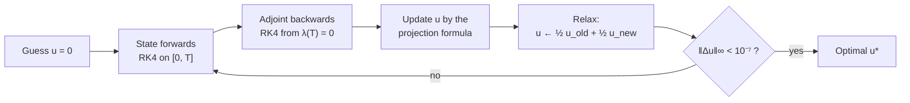

The sweep uses RK4 with 4000 time steps on $[0, 100]$ days. It converges in **31 iterations** with weights $A_1 = A_2 = 1$ and $w_1 = w_2 = 1000$. The weights are illustrative, not calibrated to real costs.

---

## 7. Results

Each strategy was optimised separately:

| Strategy | Peak infected | Cost $J$ | Infected person-days |
|---|---:|---:|---:|
| No control | 316 | 17 974 | 4 597 |
| Treatment only | 199 | 16 656 | 3 118 |
| Vaccination only | 122 | 3 558 | 648 |
| **Both controls** | **110** | **3 466** | **547** (−88%) |

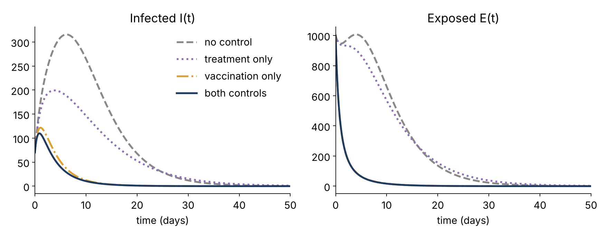

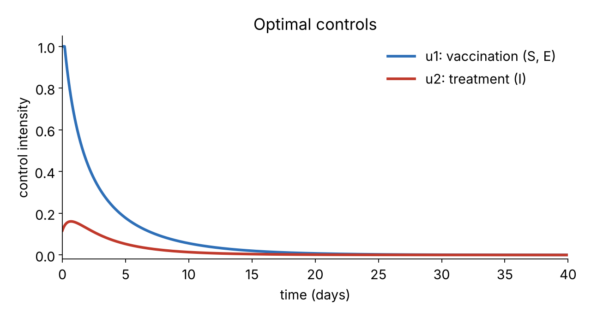

**Interpretation.** Vaccination starts at its upper bound and decays to zero by about day 18. Treatment peaks near 0.16 and is off by about day 11. **Early prevention is cheaper than later treatment.** Treatment acts only once people are already infectious, so on its own it lowers the peak but barely changes the total cost.

---

## 8. Fitting the model to data

The parameter inconsistency in Section 2 shows a missing step: the model was never fitted to data. To fill that gap, the consistent model is calibrated with **neural posterior estimation (NPE)**, a simulation-based inference method, and checked against **MCMC** with the exact likelihood.

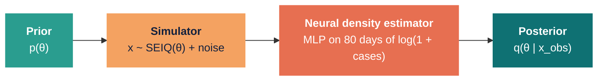

- **It needs only forward simulations**, so it also works when the likelihood is intractable, for example in stochastic or agent-based models.
- **It is amortised**: once trained, a posterior for new data takes about a second, which matters for near-real-time outbreak analysis.
- **It can be checked**: here NPE is compared with MCMC, which uses the exact likelihood, to confirm that both give the same posterior.

**Setup**
- Population $N = 10\,000$ with $A = \mu N$; initial values $E_0 = 20$, $I_0 = 10$.
- Data: 80 days of **daily new confirmed cases**, the inflow to Q, $\int(\sigma I + dE)\,dt$ per day, with negative-binomial noise (dispersion 20).
- Unknowns $\theta = (\tilde\beta, \sigma, d)$ with uniform priors on $[0.3, 2.5] \times [0.05, 0.9] \times [0, 0.3]$. The true values are the report's $(1.30, 0.50, 0.05)$.
- NPE: a mixture-density network trained on 100 000 simulations. MCMC: `emcee`, 24 walkers × 2500 steps.

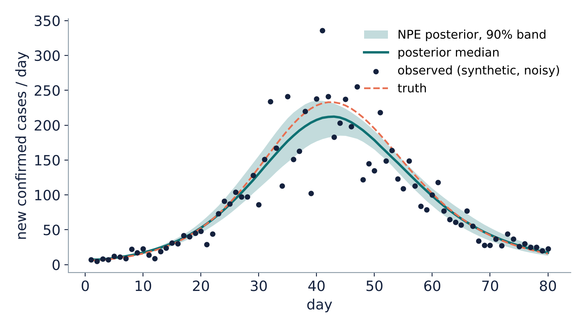

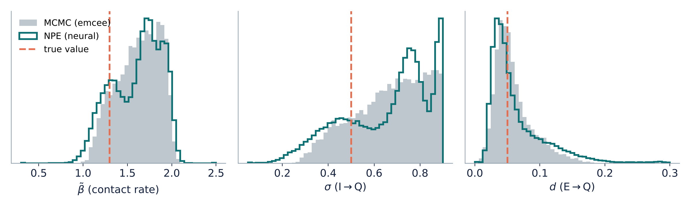

| | $\tilde\beta$ | $\sigma$ | $d$ |
|---|---|---|---|
| True value | 1.30 | 0.50 | 0.05 |
| MCMC posterior mean | 1.63 | 0.67 | 0.06 |
| MCMC 90% interval | [1.21, 1.96] | [0.39, 0.88] | [0.025, 0.116] |

| Cost | Time |
|---|---|
| MCMC, one dataset (60 000 ODE solves) | 134 s |
| NPE one-off cost: simulate and train | 366 s |
| NPE posterior for each new dataset | 0.97 s |

<p float="left">
  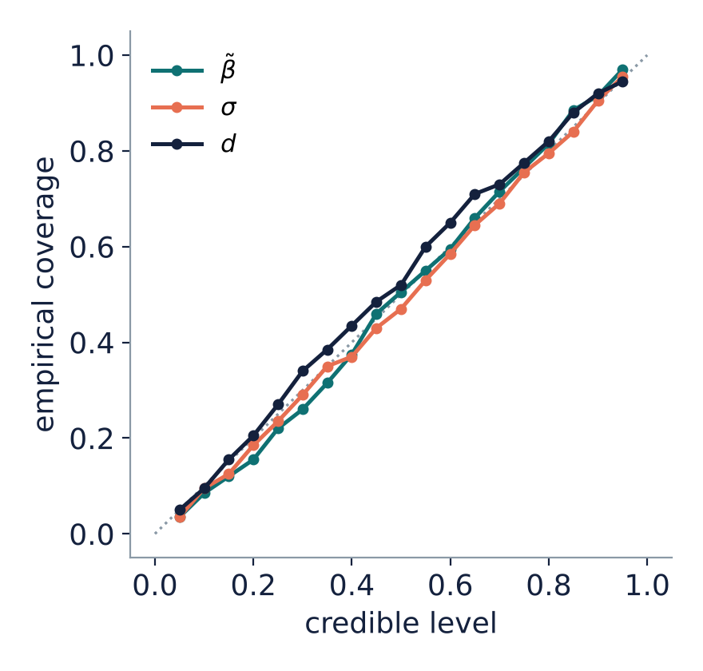
  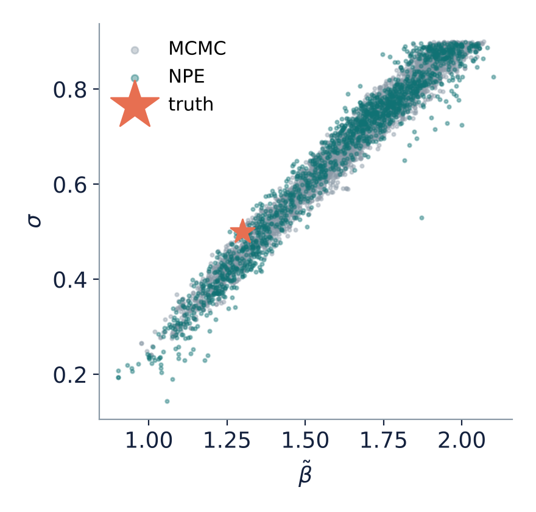
</p>

- **Calibration.** On 200 fresh datasets, the empirical coverage of the NPE credible intervals follows the diagonal, so the intervals are honest.
- **Identifiability.** $\tilde\beta$ and $\sigma$ are almost collinear ($\rho \approx 0.99$). Case data pin down the **growth rate**, not each parameter on its own, so the posterior for $\sigma$ runs into its prior bound. A second data stream, such as hospitalisations or testing data, would break this degeneracy.

---

## 9. Does the policy survive the uncertainty?

The optimal control problem (Sections 4–6) was solved on the consistent model for **300 MCMC posterior samples**. A vectorised sweep with adaptive relaxation converged for every sample (error below $10^{-5}$ in 23 iterations).

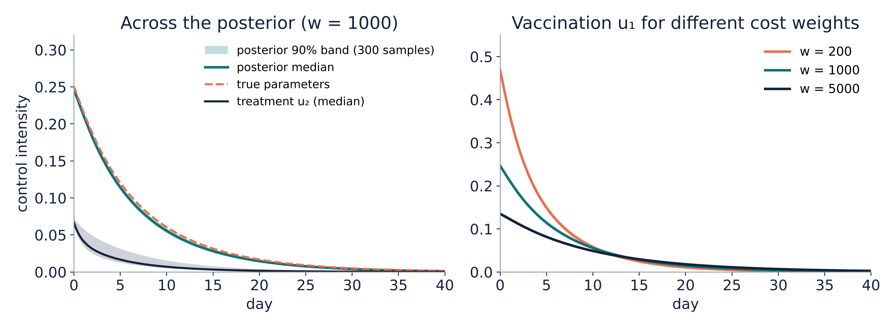

| Quantity (w = 1000) | Result across 300 samples |
|---|---|
| Vaccination highest at | day 0 in **every** sample |
| Vaccination switched off | day 22–24 (90% range) |
| Share of vaccination effort in the first 20 days | ≥ 91% in every sample |
| Initial vaccination intensity | ≈ 0.25 (median), never at the bound 1 |
| Cost of using the true-parameter policy instead of each sample's own optimum | +0.5% median, +2.0% at most |
| Initial intensity for $w$ = 200 / 1000 / 5000 | 0.47 / 0.25 / 0.13 |

**Conclusion.** "Vaccinate **early**" is robust: the data cannot separate $\tilde\beta$ from $\sigma$, but the policy does not need that split, because early on it depends on the growth rate, which the data do determine. "Vaccinate **hard**" is not robust: how strongly to vaccinate is set by the relative cost of vaccination and infection.

---

## 10. Repository structure and how to run

| File | What it does | Runtime |
|---|---|---|
| `seiq_forward_backward_sweep.py` | Sections 1, 2, 4–7: the report's model, optimal control, the four scenarios, figures `uncontrolled`, `scenarios`, `controls` | ~1 min |
| `seiq_bifurcation.py` | Section 3: endemic equilibrium, stability, bifurcation diagram, $R_c$ | seconds |
| `seiq_sbi.py` | Section 8: NPE (JAX) vs MCMC (emcee), calibration check, SBI figures | ~8–10 min |
| `seiq_mcmc_posterior.py` | Section 9: reproduces the MCMC posterior (same seed and data as `seiq_sbi.py`) | ~2 min |
| `seiq_optimal_control_posterior.py` | Section 9: optimal control for 300 posterior samples; argument = cost weight | ~1 min |
| `plot_policy_robustness.py` | Section 9: figure `policy_robustness` | seconds |
| `optimal-control-of-covial-19.ipynb` | The original 2021 notebook (see Section 11) | — |
| `figures/` | All figures used in this README | — |

```bash
pip install numpy scipy matplotlib emcee jax optax

python seiq_forward_backward_sweep.py          # Sections 1-7
python seiq_bifurcation.py                     # Section 3
python seiq_sbi.py                             # Section 8
python seiq_mcmc_posterior.py                  # Section 9: posterior samples
python seiq_optimal_control_posterior.py 200
python seiq_optimal_control_posterior.py 1000
python seiq_optimal_control_posterior.py 5000
python plot_policy_robustness.py
```

---

## 11. Limitations and honest notes

- **The 2021 notebook contains errors.** Its adjoint system was not implemented as $\lambda' = -\partial H/\partial x$, the controlled model replaced the infection term, and the sensitivity loop did not vary the parameters it reports. The notebook is kept for transparency. All results in this README come from the corrected scripts.
- **The cost weights are illustrative.** With real cost data, the balance between vaccination and treatment, and the control intensity, would change.
- **The data in Sections 8–9 are synthetic.** They show that the method can recover parameters and how uncertainty propagates to the policy; they do not validate the model against real COVID-19 data.
- **The two parameter sets answer different questions.** The report's parameters give a short outbreak far from equilibrium. The consistent model is used wherever equilibria, fitting or uncertainty matter.

---

## 12. References

- Giordano, G. et al. (2020). Modelling the COVID-19 epidemic and implementation of population-wide interventions in Italy. *Nature Medicine*, 26, 855–860.
- van den Driessche, P. & Watmough, J. (2002). Reproduction numbers and sub-threshold endemic equilibria for compartmental models of disease transmission. *Mathematical Biosciences*, 180, 29–48.
- Lenhart, S. & Workman, J. T. (2007). *Optimal Control Applied to Biological Models*. Chapman & Hall/CRC.
- Papamakarios, G. & Murray, I. (2016). Fast ε-free inference of simulation models with Bayesian conditional density estimation. *NeurIPS*.
- Foreman-Mackey, D. et al. (2013). emcee: the MCMC hammer. *PASP*, 125, 306–312.

**Authors:** Jonas Kwame Nyador (R₀, stability and Lyapunov analysis, Python implementation of the optimal control; 2026 revision, bifurcation analysis, inference and robustness study), with Justice Addae and Kingsley Opoku (2021 Modelling Camp project, MathMods).
